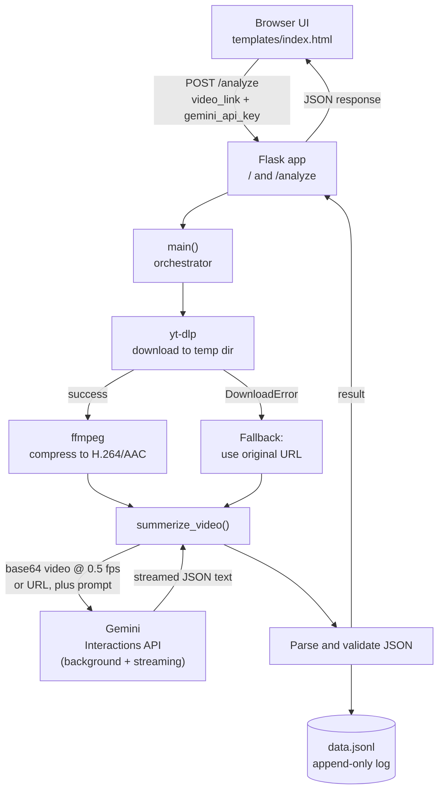

# FRAIM
A small Flask app that takes a video link and returns a structured, searchable analysis of the video's content: an overview, key points, a timestamped timeline, takeaways, and topics. It downloads and compresses the video, sends it to Google Gemini, and returns the result as validated JSON.

Users bring their own Gemini API key (BYOK), so no key is stored on the server.

## What it does

Given a video URL, the app produces a single JSON object designed to power a front end with:

* Expandable summary cards
* A detailed timeline for navigation
* Searchable events and key points
* Natural-language questions about the video's content

## System architecture

### Overview



### Components

| Component | Responsibility |
| --------- | -------------- |
| **Front end** (`templates/index.html`) | Collects the video link and the user's Gemini key, sends them to `/analyze`, and renders the returned JSON (cards, timeline, search). |
| **Flask routes** (`/`, `/analyze`) | Serve the page, validate input (400 on missing fields), build the analysis prompt with the video URL injected, and return `{"result": ...}`. |
| **Orchestrator** (`main`) | Creates a temp directory, runs download and compression, decides between file and URL mode, creates the Gemini client with the user's key, and calls the analyzer. |
| **Downloader** (yt-dlp) | Fetches best video and audio, merges to MP4, and reports metadata such as duration. |
| **Compressor** (ffmpeg via `subprocess`) | Shrinks the file for faster, smaller uploads to Gemini. |
| **Analyzer** (`summerize_video`) | Builds the multimodal request, streams events from Gemini, collects the text chunks, parses the JSON, and appends it to `data.jsonl`. |
| **Gemini** (external) | Performs the audiovisual analysis and returns JSON that follows the `video_intelligence_v2` schema. |
| **Storage** (`data.jsonl`) | Local, append-only log of results. The only persistent state in the system. |

### Request lifecycle and trust boundaries

* **Stateless server.** Apart from `data.jsonl`, nothing persists between requests. Video files live in a per-request temp directory that is removed when the request ends.
* **BYOK.** The Gemini key travels from the browser to the server in the request body, is used to create a client for that single request, and is never written to disk or logged by the app.
* **External dependencies.** Each request touches the source video host (via yt-dlp), the local `ffmpeg` binary, and the Gemini API. A failure at any of these surfaces as an error to the caller, except a download failure, which triggers the URL fallback.
* **Synchronous design.** The whole pipeline runs inside one HTTP request, so latency is dominated by download, compression, and Gemini processing time.

## How it works

1. **Request.** The front end POSTs a `video_link` and the user's `gemini_api_key` to `/analyze`.
2. **Download.** `yt-dlp` downloads the best video and audio streams (no playlists), merges them to MP4 inside a temporary directory, and reads the video duration. Fragment downloads run concurrently (16 at a time).
3. **Compression.** `ffmpeg` re-encodes the file (H.264, `veryfast` preset, AAC audio at 96k) so it is smaller and faster for Gemini to process.
4. **Fallback.** If `yt-dlp` raises a `DownloadError`, the app skips the download and passes the original URL directly to Gemini instead.
5. **Analysis.** The video (or URL) and a detailed analysis prompt are sent to Gemini through the `google-genai` Interactions API:
   * Downloaded files are sent as base64 and sampled at 0.5 fps (one frame every 2 seconds).
   * The request runs in the background with streaming enabled, so long jobs are not cancelled mid-process.
   * Thought summaries and text chunks are streamed to the server console as they arrive.
   * The response is constrained to JSON.
6. **Validation and storage.** The streamed text is joined and parsed with `json.loads`. Invalid or empty output raises a clear error. Each successful result is appended as one line to `data.jsonl`.
7. **Cleanup.** The temporary download and compressed files are deleted automatically when the request finishes.

## Output schema

Responses use the `video_intelligence_v2` schema and are returned as `{"result": { ... }}`:

```json
{
  "schema_version": "video_intelligence_v2",
  "analysis_status": "complete",
  "video": {
    "url": "",
    "title": null,
    "creator": null,
    "duration_seconds": null,
    "content_type": null,
    "language": null
  },
  "overview": { "headline": "", "preview": "", "summary": "" },
  "key_points": [
    {
      "title": "",
      "preview": "",
      "description": "",
      "timestamp_seconds": null,
      "evidence_type": "observed"
    }
  ],
  "timeline": [
    { "timestamp_seconds": 0, "title": "", "description": "" }
  ],
  "takeaways": [],
  "topics": [],
  "limitations": []
}
```

**`analysis_status`** is one of `complete`, `partial`, `unavailable`, or `reprocessing_required`.

**`evidence_type`** is one of:

* `observed`: directly visible or audible
* `interpreted`: a reasonable interpretation supported by the video
* `reported`: a claim made within the video, not independently verified

The prompt adapts its language to the video category (educational, podcast, news, music, gaming, vlog, other) and instructs the model not to invent dialogue, lyrics, names, or timestamps, and not to identify people from appearance alone.

## Tech stack

* Python
* Flask for the web server and API
* yt-dlp for video downloading
* ffmpeg for compression
* google-genai (Gemini Interactions API) for multimodal analysis

## Setup

Clone the repository:

```bash
git clone <your-repo-url>
cd <your-repo-folder>
```

Install Python dependencies:

```bash
pip install flask yt-dlp google-genai
```

Install `ffmpeg` and make sure it is on your `PATH`:

```bash
brew install ffmpeg          # macOS
sudo apt install ffmpeg      # Debian/Ubuntu
```

Get a Gemini API key from [Google AI Studio](https://aistudio.google.com/). You enter it in the app at request time; nothing needs to be set as an environment variable.

## Usage

Start the server:

```bash
python app.py
```

Open `http://localhost:5000`, paste a video link and your Gemini API key, and submit. The app serves `templates/index.html` at `/`, so that file must exist.

### API

`POST /analyze`

```json
{
  "video_link": "https://www.youtube.com/watch?v=...",
  "gemini_api_key": "your_key_here"
}
```

Example:

```bash
curl -X POST http://localhost:5000/analyze \
  -H "Content-Type: application/json" \
  -d '{"video_link": "https://www.youtube.com/watch?v=...", "gemini_api_key": "YOUR_KEY"}'
```

| Status | Meaning |
| ------ | ------- |
| 200 | Analysis succeeded, returns `{"result": {...}}` |
| 400 | Missing `video_link` or `gemini_api_key` |

Other failures (Gemini errors, invalid JSON from the model, ffmpeg errors) surface as server errors, with details printed to the console.

## Output files

* `data.jsonl`: every successful analysis is appended as one JSON object per line, useful for reuse, search indexing, or debugging.

## Known limitations & next fixes
* **Large videos may exceed inline limits.** Downloaded videos are sent as base64 in the request body, so long or high-resolution videos can hit size limits even after compression.
* **Requests are synchronous.** The Flask route blocks until download, compression, and analysis finish. A job queue with polling or server-sent events would suit longer videos better.
* **URL fallback is limited.** When the download fails, Gemini receives only the URL and may not be able to access it, which can lead to `partial` or `unavailable` results.
* **Unused duration value.** The duration from `yt-dlp` is read but not passed into the analysis.
* **Development settings.** The app runs with `debug=True` and has no authentication or rate limiting, so it should not be exposed publicly as is.
* **Unbounded log growth.** `data.jsonl` is append-only with no rotation.
* **No UI documentation.** The front-end template is not covered here.

## Notes on responsible use

* Only analyze videos you have the right to download and process, and respect the terms of service of the source platform.
* The model's output describes what it observed or was told in the video. Claims in the video are labeled `reported` and are not independently verified.
